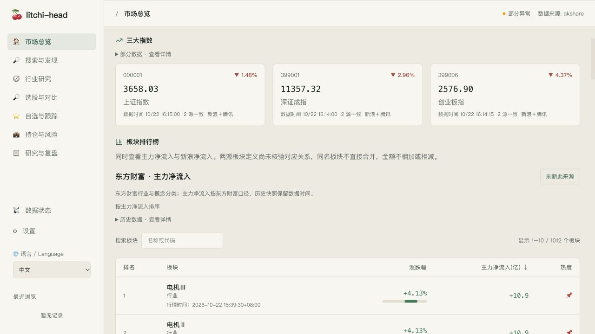
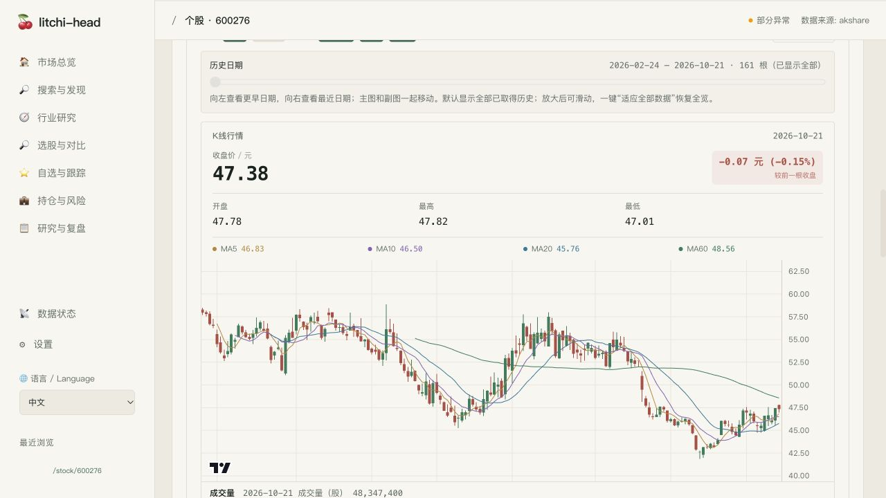
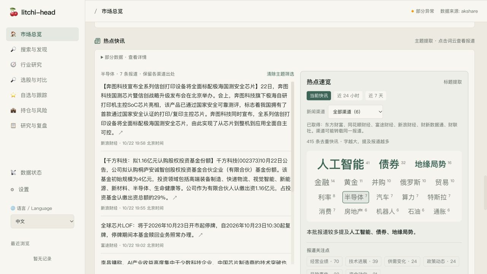

# Litchi Head

**A multi-agent research platform for Chinese A-share markets, connecting market data, evidence validation and peer review in a traceable workflow.**

[中文](README.md) · [Architecture decisions](docs/05-decisions/README.md) · [Module documentation](docs/03-modules/README.md) · [CI](https://github.com/NoahLightryyy/litchi-head/actions)

Python · LangGraph · Pydantic · FastAPI · Next.js · TypeScript

## Overview

Litchi Head is a locally runnable, full-stack AI research system. Users can explore markets, sectors, stocks and ETFs, inspect prices and financial data, trace policy evidence, and obtain structured research through specialized agents, peer review and risk assessment.

The central engineering question is: **How can multi-agent analysis depend on inspectable evidence while remaining understandable when data is incomplete, services fail or tasks are interrupted?** The implementation connects data provenance, typed contracts, task state and model output within one workflow.

Delivered components include a LangGraph orchestration engine, cross-source data validation, recoverable research tasks, a web application and automated validation. A local re-verification on November 17, 2026 recorded **2,827 passing Python tests and 331 passing frontend tests** (dependencies pinned by `constraints.txt`, Linux, Python 3.12); see the [verification log](docs/04-changelog/logs/2026-11-17/2026-11-17-merge-and-etf-catalog.md). For CI after the merge, refer to the [Actions page](https://github.com/NoahLightryyy/litchi-head/actions); the last passing integration snapshot is from [October 22, 2026](https://github.com/NoahLightryyy/litchi-head/actions/runs/39772044194).

## Recent changes

- **November 17, 2026 — merge and overseas availability.** The `codex/market-availability` line, previously a local preview only, is merged, so the repository has a single mainline again. When the system resolver cannot resolve market-data hosts (common on overseas networks), the backend falls back to DNS over HTTPS. The ETF catalog is no longer rejected outright when the source's reported count differs slightly from the listed entries; it is accepted and the difference is disclosed above search results. When the model service is unreachable, the call waits and retries, and a remaining failure is reported as a network outage instead of a generic request failure. [Log](docs/04-changelog/logs/2026-11-17/2026-11-17-merge-and-etf-catalog.md)
- **November 16, 2026 — stabilization.** Dependencies pinned in `constraints.txt`, one-click start and stop scripts for macOS and Windows, and the debate orchestrator split into five modules. [Log](docs/04-changelog/logs/2026-11-16/2026-11-16-v1-stabilize.md)
- **November 4, 2026.** Insufficient model balance is shown separately from insufficient market evidence, and runs where every school failed no longer produce a consensus or a review record; ETF daily bars include the current day when the source provides it; ETF search matches theme and manager in any order; stock research adds adjusted-price indicators and volume comparison.
- **October 27, 2026.** Research accepts a single valid quote source; one-click watchlist with plain-language reminders; consolidated policy and news interpretation; technical indicators reuse the fallback daily bars; reviews update historical closing changes automatically; stock quotes and intraday charts recover when some sources fail.

Earlier entries are in the [work log index](docs/04-changelog/logs/README.md) (Chinese).

## Interface preview

Screenshots from the locally running application on October 22, 2026, showing market discovery, stock charts and topic-based news browsing. Source timestamps and historical-data labels remain visible. Detailed diagnostics are collapsed by default and accessible through disclosure controls or the header status link.

**Market overview · Cross-source indices and sector rankings**



| Stock candles and moving averages | News topics and source traceability |
|---|---|
| [](docs/assets/screenshots/stock-chart.jpg) | [](docs/assets/screenshots/news-topics.jpg) |

Click an image to view it at full size. The screenshots show the Chinese interface.

## User workflow

1. **Find a research subject:** explore markets and sectors, search stocks or ETFs, and inspect quotes, charts, financial indicators and source timestamps.
2. **Inspect the evidence:** review policy materials, citations and industry relationships. Source-backed maps and AI drafts labeled as unverified inference are presented separately.
3. **Run multi-perspective analysis:** once evidence gates pass, initiate analysts, strategy perspectives, peer review, independent assessment and aggregation.
4. **Review and follow up:** inspect structured findings and risk information, restore debate status when revisiting a page, and retain research and action records for reflection.

Stock, sector and ETF pages provide research entry points. `/policy` and `/capital` provide historical-policy and hypothetical-capital demonstrations. Capital previews use deterministic calculations and show whether account, fee and other required inputs are available.

## Engineering contributions

| Engineering question | Implementation | Entry point |
|---|---|---|
| How can multiple roles share a consistent structure? | LangGraph coordinates analysis, peer review, independent assessment and risk review; Pydantic validates data across module boundaries | [Orchestrator](src/debate/orchestrator.py) · [Nodes](src/debate/graph_nodes.py) · [Models](src/debate/models.py) |
| What happens when evidence conflicts or expires? | Cross-source market/news checks retain provenance, timestamps and diagnostics; missing critical evidence blocks formal debate before model calls | [Evidence service](src/data/evidence_service.py) · [Gate](src/debate/evidence_gate.py) |
| How are intraday states separated from historical bars? | Separate completed daily bars from provisional intraday data, with components for RAW-data auditing, corporate actions and adjustment verification | [Price-data contracts](src/data/kline_business.py) · [Adjustments](src/data/kline_adjustment.py) |
| How can long-running research recover? | SQLite-backed policy research tasks link archived evidence and citations, enforce budget checks and preserve explicit failure states | [Research runtime](backend/policy_research.py) · [Runtime tests](tests/test_backend/test_policy_research_runtime.py) |
| How are monetary calculations kept out of language-model output? | Research generation is separate from Decimal-based single-buy calculations; typed contracts validate account, fee and permission context | [Capital preview](backend/capital_preview.py) · [Contract tests](tests/test_backend/test_policy_capital_contract.py) |
| How is the system delivered to users? | FastAPI and Next.js expose market data, charts, research status, failure diagnostics and task recovery, with CI across both stacks | [API](backend/main.py) · [Web app](frontend/) · [CI configuration](.github/workflows/ci.yml) |
| What if an overseas network cannot resolve market-data hosts? | Only after the system resolver fails, A records are fetched over HTTPS from public resolvers, cached by TTL, filtered for private addresses and counted in the data-source health statistics | [DNS fallback](src/utils/dns_fallback.py) · [Tests](tests/test_utils/test_dns_fallback.py) |
| How are model-call failures explained? | Insufficient balance, connection outage, response timeout and output-validation failure are distinguished; connection outages are retried within the same call, and failed runs never pass as research conclusions | [LLM adapter](src/utils/llm.py) · [Error classification](src/utils/llm_errors.py) |
| Does it behave the same on another machine? | Dependency versions are pinned and shared by CI, Docker and the launchers; one-click scripts check the environment, install, build and start | [Constraints](constraints.txt) · [macOS launcher](start.command) · [Windows launcher](scripts/start.ps1) |

## Architecture

```text
Market / news / financial data / policy materials
                       ↓
Adapters → provenance and freshness checks → typed evidence
                       ↓
Evidence gate → analysts → strategy perspectives → peer review
                       ↓
Independent assessment / aggregation → risk / planning → human review
                       ↓
Research records / reflection / trust statistics

FastAPI API ←→ Next.js web interface
```

Evidence validity, research generation and trade readiness are modeled separately, allowing the interface to expose errors and missing inputs. All model calls use a shared [LLM adapter](src/utils/llm.py). The current default is `deepseek-v4-pro` with thinking disabled, governed by `DEFAULT_MODEL`.

## Validation and research evaluation

**Engineering validation.** The October 22, 2026 integration snapshot recorded 2,451 passing Python tests, 7 skipped and 19 deselected; 160 frontend tests and the production build passed. CI includes Ruff, Pyright, Python 3.12/3.13 tests and coverage checks, plus frontend tests, type checking and builds. These snapshot-specific results are documented in the [validation log](docs/04-changelog/logs/2026-10-22/2026-10-22-remaining-integration.md) and [CI run](https://github.com/NoahLightryyy/litchi-head/actions/runs/39772044194).


Re-verified on November 17, 2026 after merging `codex/market-availability`, with dependencies pinned by `constraints.txt` (Linux, Python 3.12): Ruff and Pyright pass, 2,827 Python tests pass with 8 skipped, and 331 frontend tests pass; see the [merge log](docs/04-changelog/logs/2026-11-17/2026-11-17-merge-and-etf-catalog.md) and the [stabilization log](docs/04-changelog/logs/2026-11-16/2026-11-16-v1-stabilize.md).

**Research evaluation.** The repository implements [E0 offline sampling, execution and result storage](src/backtest/e0/) and preserves a [six-case research smoke test with raw records](docs/02-requirements/differentiation/SMOKE_RESULT_2026-10-18.md). The smoke test checks the research workflow; its small sample and unequal call budgets do not establish an advantage over a single-model baseline. Further comparisons follow the [baseline and shadow-validation plan](docs/02-requirements/DECISION_BASELINE_AND_SHADOW_VALIDATION.md).

**Scope.** The system supports research and human review. Its trading module provides plans and position calculations without live brokerage execution. Complete production provenance, continuous shadow evaluation and confidence calibration against real outcomes remain ongoing; test results do not establish investment returns. AI industry drafts are explicitly unverified inferences, not evidence of actual company relationships. Hand-verified policy evidence packages currently cover three sample subjects only (sector BK0917, stock 688012, ETF 512480); for every other subject the verified-evidence and deep-research panel states that it is unavailable.

## Run locally

Requires Python 3.12+. Node.js 24 and pnpm 10.33.0 match the frontend CI environment. Live AI research requires DeepSeek credentials and access to upstream data services. A fresh deployment needs time to accumulate news coverage; unavailable critical sources produce explicit debate-blocking diagnostics. Automatic AI drafts may incur provider charges; successful results are cached.

```bash
git clone https://github.com/NoahLightryyy/litchi-head.git
cd litchi-head
python -m venv .venv
source .venv/bin/activate  # Windows PowerShell: .venv\Scripts\Activate.ps1
pip install -e ".[dev]" -c constraints.txt
cp .env.example .env      # PowerShell: Copy-Item .env.example .env

# Store credentials interactively in the OS credential manager.
python scripts/store-api-keys.py --set DEEPSEEK_API_KEY

corepack enable
corepack prepare pnpm@10.33.0 --activate
pnpm --dir frontend install --frozen-lockfile
```

**One-click start (recommended for daily use).** Double-click `start.command` on macOS or `start.bat` on Windows. The launcher checks Python/Node, installs dependencies on first run (pinned by `constraints.txt`), builds the frontend, starts both services and opens the browser; on failure it prints the cause and the log location. To stop the services, double-click `stop.command` on macOS or `stop.bat` on Windows.

On overseas networks there is no need to change the system DNS: the backend enables a DNS fallback at startup that only steps in when the system resolver fails; set `LITCHI_DNS_FALLBACK=0` to disable it. Connections from abroad to mainland data sources can still be slow or time out occasionally.

For development, start two terminals from the repository root:

```bash
# Terminal 1, with the Python environment activated
python -m uvicorn backend.main:app --reload --port 8000

# Terminal 2
pnpm --dir frontend dev
```

Open the [web app](http://localhost:3000) or [OpenAPI documentation](http://localhost:8000/docs). Navigate from the market view to a sector and stock, inspect source timestamps, then initiate research using the page controls. If evidence gates block analysis, inspect the diagnostics.

## Validation

```bash
python scripts/check.py          # Static checks and change-selected tests
python scripts/check.py --full   # Full non-slow subset
pnpm --dir frontend test
pnpm --dir frontend type-check
pnpm --dir frontend build
```

Live model calls incur provider charges. Isolated tests do not replace live quality evaluation. See the [environment guide](docs/01-guides/ENVIRONMENT.md) for configuration details.

## Repository guide

- [src/](src/): data, agents, debate, memory, risk and backtesting.
- [backend/](backend/) / [frontend/](frontend/): API service and web application.
- [tests/](tests/): unit, contract and integration tests.
- [Architecture decisions](docs/05-decisions/README.md): design rationale and trade-offs.
- [Learning notes](docs/learning/README.md): explanations grounded in project code.
- [Roadmap](docs/00-overview/ROADMAP.md) / [technical debt](docs/01-guides/debt/ROUTER.md): progress and unresolved limitations.

Development uses AI-assisted coding and documentation, with records in the [work log](docs/04-changelog/logs/README.md). Technical claims should be checked against code, tests and experiment records. Most detailed project documentation is in Chinese.

[Git-validated session recovery](docs/01-guides/workflow/SESSION_RECOVERY.md) uses Git/worktree evidence as the source of truth; snapshots are validated caches.

## License

[GNU AGPL v3](LICENSE)
