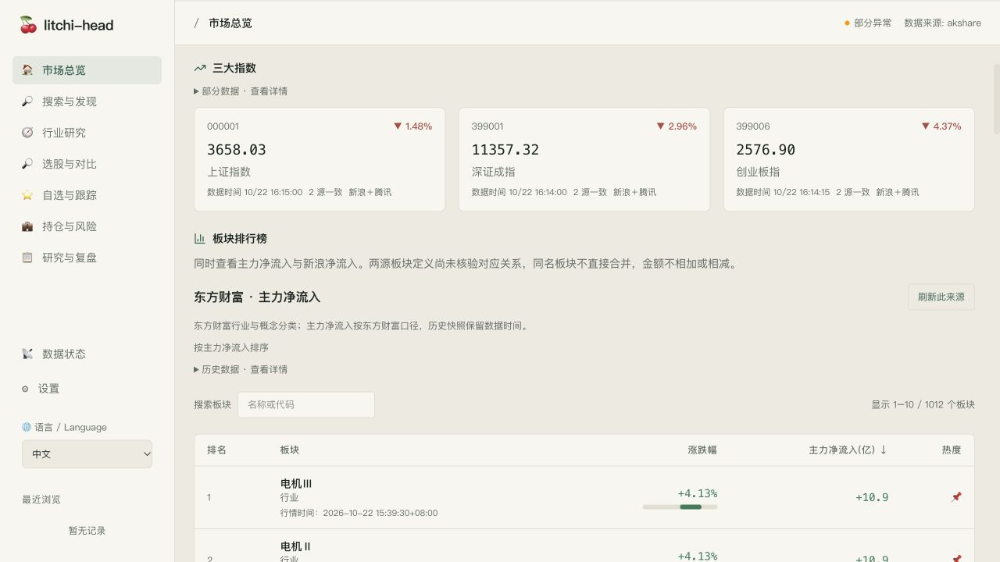
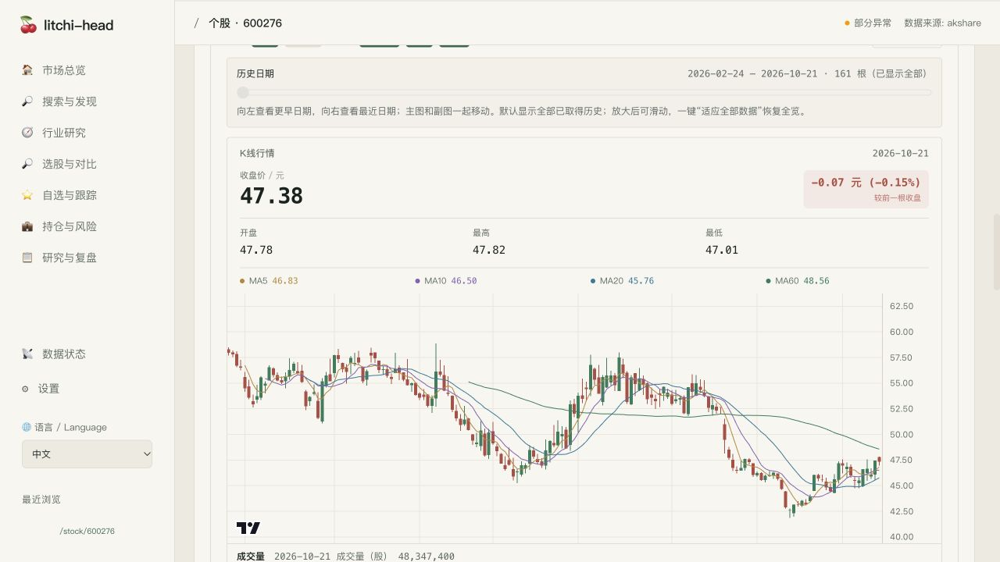
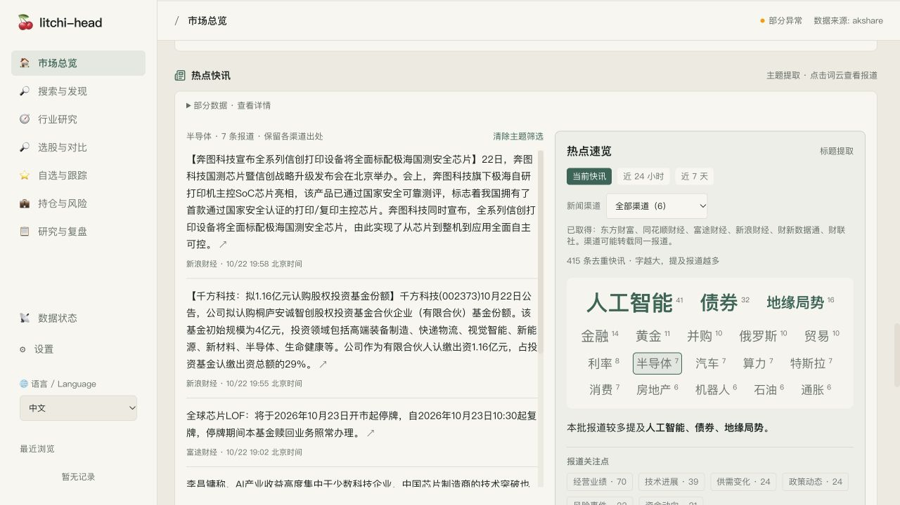

# Litchi Head · 荔枝头

**面向 A 股研究的多智能体平台，将市场数据、证据校验与交叉评审连接成可追溯的分析流程。**

[English](README.en.md) · [架构决策](docs/05-decisions/README.md) · [模块文档](docs/03-modules/README.md) · [CI](https://github.com/NoahLightryyy/litchi-head/actions)

Python · LangGraph · Pydantic · FastAPI · Next.js · TypeScript

## 项目概览

Litchi Head 是一个可本地运行的全栈 AI 研究系统。用户可以从市场、板块、股票或 ETF 进入研究，查看行情与财务信息、追踪政策证据，并通过多智能体分析、同侪复核和风控审阅获得结构化研究结果。

项目关注的技术问题是：**如何让多智能体分析依赖可检查的数据，并在证据不足、外部服务失败或任务中断时保持行为可解释？** 为此，系统将数据来源、类型契约、任务状态和模型输出纳入同一条处理链路。

已交付的工程成果包括 LangGraph 编排引擎、多源数据校验、可恢复研究任务、Web 应用与自动化验证。2026-11-17 本地复验为 **2,827 项 Python 测试、331 项前端测试通过**（按 `constraints.txt` 锁定依赖，Linux / Python 3.12）；[复验记录](docs/04-changelog/logs/2026-11-17/2026-11-17-merge-and-etf-catalog.md)。合并后的 GitHub CI 以 [Actions 页面](https://github.com/NoahLightryyy/litchi-head/actions) 为准，上一次通过的集成快照是 [2026-10-22](https://github.com/NoahLightryyy/litchi-head/actions/runs/39772044194)。

## 近期更新

- **2026-11-17 合并与海外可用性。** 此前只在本地预览的 `codex/market-availability` 已合入，仓库回到单一主线。系统 DNS 解析不了行情域名时（海外网络常见）自动改用备用解析；ETF 目录在来源自报总数与实际条数小幅不符时不再整体拒绝，改为接受并在搜索结果上方披露；模型服务连接中断时先等待重试，仍失败则写明是断网而不是笼统的请求失败。[记录](docs/04-changelog/logs/2026-11-17/2026-11-17-merge-and-etf-catalog.md)
- **2026-11-16 收尾。** 依赖版本锁定到 `constraints.txt`，新增 macOS / Windows 一键启动与停止脚本，辩论编排器拆分为五个模块。[记录](docs/04-changelog/logs/2026-11-16/2026-11-16-v1-stabilize.md)
- **2026-11-04。** 模型余额不足与市场证据不足分开显示，全部流派失败的任务不再给出方向共识或计入复盘（[记录](docs/04-changelog/logs/2026-11-04/2026-11-04-debate-balance-failure.md)）；ETF 日线包含来源已提供的当日数据（[记录](docs/04-changelog/logs/2026-11-04/2026-11-04-etf-current-day.md)）；ETF 搜索支持主题与管理人任意顺序组合（[记录](docs/04-changelog/logs/2026-11-04/2026-11-04-etf-search.md)）；普通股票研究接入前复权指标与成交量对比（[记录](docs/04-changelog/logs/2026-11-04/2026-11-04-adjusted-volume.md)）。
- **2026-10-27。** 行情研究统一为一个有效来源即可使用（[记录](docs/04-changelog/logs/2026-10-27/2026-10-27-single-source-research.md)）；自选一键关注与通俗提醒（[记录](docs/04-changelog/logs/2026-10-27/2026-10-27-plain-watchlist.md)）；政策新闻综合解读（[记录](docs/04-changelog/logs/2026-10-27/2026-10-27-policy-synthesis.md)）；技术指标复用备用日线（[记录](docs/04-changelog/logs/2026-10-27/2026-10-27-technical-indicators.md)）；复盘自动更新历史收盘变化（[记录](docs/04-changelog/logs/2026-10-27/2026-10-27-retro-and-sector-summary.md)）；个股报价与分时在部分来源故障时恢复显示（[报价](docs/04-changelog/logs/2026-10-27/2026-10-27-stock-quote-recovery.md)、[分时](docs/04-changelog/logs/2026-10-27/2026-10-27-intraday-recovery.md)）。

更早的记录见 [工作日志索引](docs/04-changelog/logs/README.md)。

## 界面预览

2026-10-22 本地运行实景，展示市场发现、个股图表和新闻主题浏览；行情日期、来源与历史数据标记保留在界面中。详细诊断默认收起，可从“查看详情”或顶部状态入口展开。

**市场总览 · 多源指数与板块排行**



| 个股 K 线与均线 | 新闻主题与来源追踪 |
|---|---|
| [](docs/assets/screenshots/stock-chart.jpg) | [](docs/assets/screenshots/news-topics.jpg) |

点击图片可查看原尺寸。

## 使用流程

1. **发现研究对象**：浏览市场与行业板块，搜索股票或 ETF，查看行情、K 线、财务指标与数据时间。
2. **核对研究证据**：查看政策材料、引用与产业关系；资料地图与标注为“待核验”的 AI 推断草图区分展示。
3. **组织多角度分析**：通过证据门禁后启动分析师、策略观点、同侪复核、独立评审与聚合流程。
4. **审阅并跟踪结果**：阅读结构化分析与风险信息；返回页面可恢复辩论任务状态，研究与操作记录支持后续反思。

产业结构草图可按环节补充代表企业、业务角色、影响力理由和资料来源；核对名称代码后可进入A股详情。公司清单独立缓存，重访不重复生成，影响力判断与真实供货关系分开。

ETF 详情现可查看三位价格的日/周/月 K 线并启动完整多轮辩论；使用基金行情与主题材料，缺少净值或持仓时明确说明，股票和基金历史独立保存。

股票、板块和 ETF 页面提供研究入口，并按名称、主营业务和主题关键词检索已有政策与报道，保留原文、日期和匹配理由；用户可修改检索词，浏览无需预置证据包，也不产生 AI 研究费用。该功能检索已收录资料，不代表全网政策全集或已核验结论。`/policy` 与 `/capital` 提供历史政策与假设资金演示。本金预览使用确定性计算，并明确展示账户、费用等输入是否满足要求。

股票名称搜索按原有四个市场独立加载：一个市场失败不会清空其他市场结果，失败后可重新搜索；部分目录会提示范围，不把无结果当成无此股票。2026-10-27已用京泉华002885实网验证。外部行情源仍可能发生网络错误，来源故障与服务连通状态分开显示。

## 核心技术贡献

| 技术问题 | 实现方式 | 代码入口 |
|---|---|---|
| 多角色分析如何保持结构一致？ | 使用 LangGraph 状态图组织分析、互评、独立评审与风控，以 Pydantic 校验跨模块数据 | [编排引擎](src/debate/orchestrator.py) · [节点](src/debate/graph_nodes.py) · [类型模型](src/debate/models.py) |
| 数据冲突或过期时如何控制分析？ | 记录行情与新闻来源、时间与诊断；关键身份或价格冲突阻断分析，覆盖缺口允许带范围说明的研究 | [证据服务](src/data/evidence_service.py) · [门禁](src/debate/evidence_gate.py) |
| 如何区分盘中状态与历史日线？ | 分离完成日线与临时盘中数据，实现 RAW 数据审计、公司行动与复权核验组件 | [K 线契约](src/data/kline_business.py) · [复权核验](src/data/kline_adjustment.py) |
| 长耗时研究如何恢复和追踪？ | 以 SQLite 保存政策研究任务，关联归档材料与引用，执行预算检查并保留失败状态 | [研究运行时](backend/policy_research.py) · [运行时测试](tests/test_backend/test_policy_research_runtime.py) |
| 如何避免语言模型承担金额运算？ | 将研究生成与 Decimal 单笔买入计算分离，以类型契约校验账户、费用和权限上下文 | [本金预览](backend/capital_preview.py) · [契约测试](tests/test_backend/test_policy_capital_contract.py) |
| 如何将系统交付给用户？ | 通过 FastAPI 与 Next.js 实现行情、图表、研究状态、失败诊断和任务恢复，并以 CI 验证前后端 | [API](backend/main.py) · [Web 应用](frontend/) · [CI 配置](.github/workflows/ci.yml) |
| 海外网络解析不了行情域名怎么办？ | 系统解析失败时才通过 HTTPS 向公共解析服务查询，按 TTL 缓存，丢弃私有地址，使用情况计入数据源健康统计 | [备用解析](src/utils/dns_fallback.py) · [测试](tests/test_utils/test_dns_fallback.py) |
| 模型调用失败如何说清原因？ | 区分余额不足、连接中断、响应超时与输出校验失败；连接中断在同一次调用内等待重试，失败任务不冒充研究结论 | [LLM 适配层](src/utils/llm.py) · [错误分类](src/utils/llm_errors.py) |
| 换一台机器还能跑出同样的结果吗？ | 依赖版本锁定，CI、Docker 与启动脚本使用同一份约束；一键脚本负责环境检查、安装、构建与启动 | [版本约束](constraints.txt) · [macOS 启动](start.command) · [Windows 启动](scripts/start.ps1) |

## 系统架构

```text
行情 / 新闻 / 财务 / 政策材料
              ↓
数据适配 → 来源与时间校验 → 类型化证据
              ↓
证据门禁 → 分析师 → 策略观点 → 同侪复核
              ↓
独立评审与聚合 → 风控 / 计划 → 人工审阅
              ↓
研究记录 / 反思 / 信任度统计

FastAPI API ←→ Next.js Web 界面
```

数据校验、研究生成和交易就绪状态分别建模。研究结果默认展示简短的数据依据与影响，完整来源诊断可展开；休市收盘价和有限新闻样本不作为整体报错，数据冲突、缺评审和分析失败仍单独提示。所有模型调用通过统一的 [LLM 适配层](src/utils/llm.py)；当前默认模型为 `deepseek-v4-pro` 非思考模式，以 `DEFAULT_MODEL` 为准。

## 验证与研究评估

**工程验证。** 2026-10-22 集成快照中，Python 测试 2,451 项通过、7 项跳过、19 项排除；前端 160 项通过，生产构建通过。CI 包含 Ruff、Pyright、Python 3.12/3.13 测试与覆盖率检查，以及前端测试、类型检查和构建。数字对应该快照，可通过 [验收记录](docs/04-changelog/logs/2026-10-22/2026-10-22-remaining-integration.md) 和 [CI 运行](https://github.com/NoahLightryyy/litchi-head/actions/runs/39772044194) 核查。

2026-11-17 合并 `codex/market-availability` 后复验（按 `constraints.txt` 锁定依赖，Linux / Python 3.12）：Ruff、Pyright 通过，Python 2,827 项通过、8 项跳过，前端 331 项通过；[合并记录](docs/04-changelog/logs/2026-11-17/2026-11-17-merge-and-etf-catalog.md)、[收尾记录](docs/04-changelog/logs/2026-11-16/2026-11-16-v1-stabilize.md)。

**研究评估。** 已实现 [E0 离线评测的采样、运行与结果存储](src/backtest/e0/)，并保存 [六题研究烟测及原始记录](docs/02-requirements/differentiation/SMOKE_RESULT_2026-10-18.md)。后者用于检查研究流程：样本小、调用预算不同，因此不用于推断多智能体优于单模型。后续对照设计见 [Baseline 与影子验证计划](docs/02-requirements/DECISION_BASELINE_AND_SHADOW_VALIDATION.md)。

**适用范围。** 本项目用于研究辅助与人工审阅，交易模块提供计划和仓位计算，未连接券商自动下单。完整生产数据血缘、连续影子验证与真实结果上的置信度校准仍在推进；测试成绩不代表投资收益。AI 草图是明确标注的未核验推断，不能作为真实公司关系证据。人工核验的政策证据包目前只覆盖 3 个示例标的（板块 BK0917、股票 688012、ETF 512480），其余标的的“已核验证据与 AI 深入研究”会说明不可用。

## 本地运行

需要 Python 3.12+；前端建议与 CI 一致使用 Node.js 24、pnpm 10.33.0。真实 AI 研究还需要 DeepSeek 凭据与可访问的数据源。首次部署需要积累新闻覆盖窗口；关键上游不可用时，正式辩论会展示阻断诊断。AI 草图自动生成可能调用付费模型，成功结果会缓存。

```bash
git clone https://github.com/NoahLightryyy/litchi-head.git
cd litchi-head
python -m venv .venv
source .venv/bin/activate  # Windows PowerShell: .venv\Scripts\Activate.ps1
pip install -e ".[dev]" -c constraints.txt
cp .env.example .env      # PowerShell: Copy-Item .env.example .env

# 交互式写入系统凭据管理器，不把密钥提交到仓库
python scripts/store-api-keys.py --set DEEPSEEK_API_KEY

corepack enable
corepack prepare pnpm@10.33.0 --activate
pnpm --dir frontend install --frozen-lockfile
```

**一键启动（推荐日常使用）。** macOS 双击 `start.command`，Windows 双击 `start.bat`。脚本会检查 Python/Node、首次自动安装依赖（按 `constraints.txt` 锁定版本）、构建前端、启动服务并打开浏览器；失败时给出原因和日志位置。停止服务：macOS 双击 `stop.command`，Windows 双击 `stop.bat`。

在海外网络使用时不需要改系统 DNS：后端启动时会启用备用域名解析，只在系统解析失败时介入，可用 `LITCHI_DNS_FALLBACK=0` 关闭。从海外连接国内行情源仍可能较慢或偶发超时。

开发调试时可在仓库根目录分别启动两个终端：

```bash
# 终端 1（已激活 Python 环境）
python -m uvicorn backend.main:app --reload --port 8000

# 终端 2
pnpm --dir frontend dev
```

打开 [Web 界面](http://localhost:3000) 或 [OpenAPI 文档](http://localhost:8000/docs)。从市场榜单进入板块和个股，查看数据时间与来源，再按页面提示发起研究。数据门禁未满足时应查看诊断，不能把阻断当成“无风险”结论。

## 开发验证

```bash
python scripts/check.py          # 静态检查 + 按改动选择测试
python scripts/check.py --full   # 完整非慢测子集
pnpm --dir frontend test
pnpm --dir frontend type-check
pnpm --dir frontend build
```

真实模型调用涉及供应商费用；常规隔离测试不能代替实网质量验收。环境和数据源细节见 [环境指南](docs/01-guides/ENVIRONMENT.md)。

## 仓库导航

- [src/](src/)：数据、Agent、辩论、记忆、风控和回测模块。
- [backend/](backend/) / [frontend/](frontend/)：API 服务与 Web 应用。
- [tests/](tests/)：契约、单元与集成测试。
- [架构决策记录](docs/05-decisions/README.md)：选型理由与权衡。
- [学习卡片](docs/learning/README.md)：结合实际代码解释关键技术。
- [路线图](docs/00-overview/ROADMAP.md) / [技术债务](docs/01-guides/debt/ROUTER.md)：进度与未解决问题。

开发过程中使用 AI 辅助编码与文档整理，相关工作日志保留在 [changelog](docs/04-changelog/logs/README.md)。技术结论应通过代码、测试与实验记录核查。

[Git 校验的会话恢复](docs/01-guides/workflow/SESSION_RECOVERY.md)：Git/worktree 是恢复依据，会话快照仅作为校验后的缓存。

## License

[GNU AGPL v3](LICENSE)
